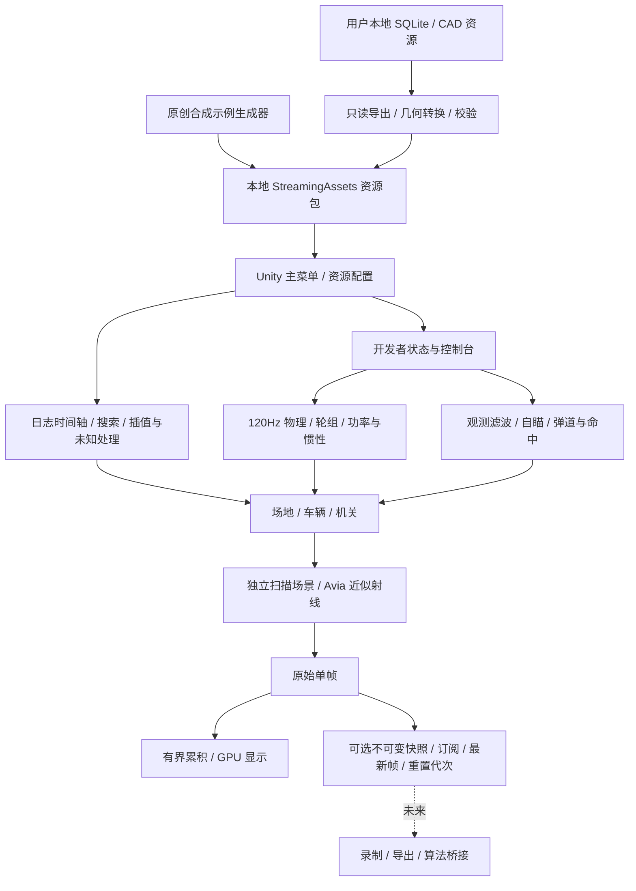

# 逻辑架构

大部分 UI 与场景协调代码使用 ReplayViewer 的 partial 文件。DeveloperWorld 管理规则和可编辑状态，DeveloperPhysicsWorld/VehiclePhysics 管理刚体和轮组；历史回放保持日志驱动，不用开发者物理覆盖原始状态。

外部算法尚未连接。点云 API 属于进程内数据扩展，显示累积不能直接用作算法单时刻输入。正式资源与源码/合成示例分开，不在 Git 中存放缓存或赛事包。
